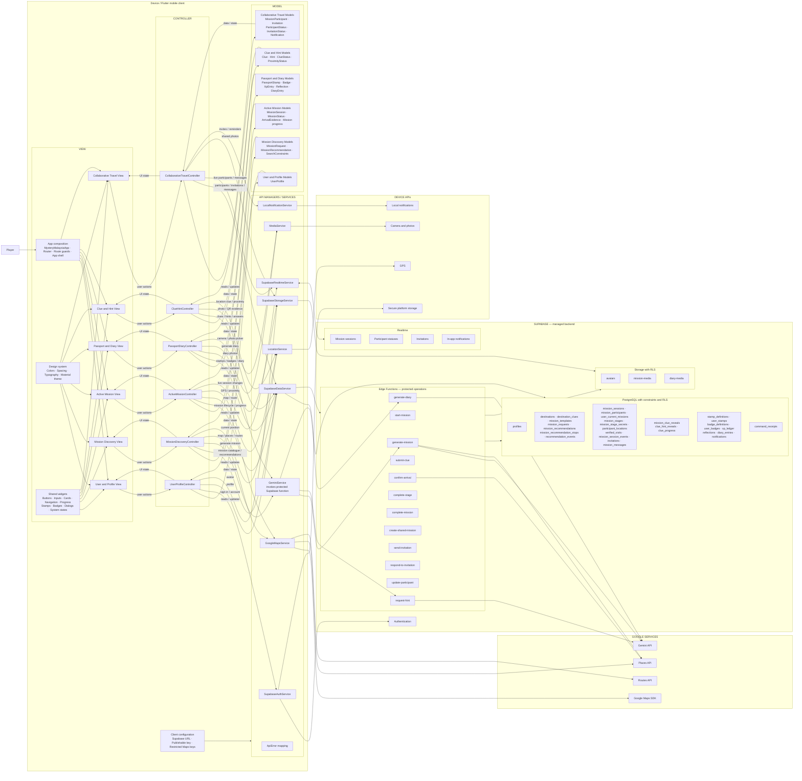
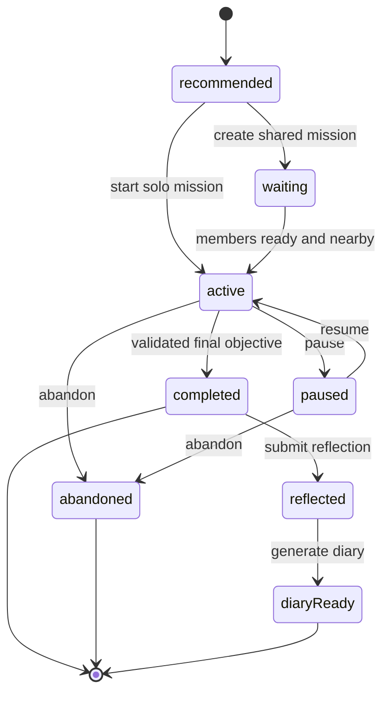

# Mystery Malaysia MVC Architecture

Status: **Accepted — implementation contract**
Architecture: **Client-side Model–View–Controller (MVC)**
Platform: Flutter mobile application
External services: Supabase, Google Maps Platform, Gemini API

All production code must follow this document. Update this document whenever an MVC component, API Manager, external provider, database table, or route changes.

## 1. Architecture decision

The Flutter application uses MVC:

- **View:** renders Flutter UI and sends user actions to a Controller.
- **Controller:** owns UI/workflow state, validates actions, coordinates Models, and calls API Managers.
- **Model:** represents application data and deterministic state rules. Models do not render UI or call APIs.
- **API Managers/Services:** isolate Supabase, Google Maps, Gemini, and device SDK calls. They are supporting infrastructure, not a fourth MVC role.

The application has no separately maintained custom server. Supabase is the managed backend. Production Gemini requests pass through a Supabase Edge Function so the Gemini credential is not embedded in the mobile application.

## 2. Complete component diagram



## 3. Allowed communication

```text
View ──user action──> Controller
View <──UI state───── Controller

Controller ──reads/updates──> Model
Controller <──data/state───── Model

Controller ──request──> API Manager / Service ──> External API
Controller <──Model──── API Manager / Service <── External API
```

Rules:

- Views may import Controllers, Models required for display, shared widgets, and theme.
- Views never call Supabase, Google Maps services, Gemini, Storage, or device APIs directly.
- Controllers may import Models and Services. They contain no Flutter widget-building code.
- Models import neither Flutter UI nor Services.
- Services own all external SDK/API calls and convert responses into Models or typed errors.
- One Controller may coordinate several Services. Do not create a single global `ApiManager` switchboard.

## 4. Required repository organization

```text
mystery_malaysia/
├── lib/
│   ├── main.dart
│   ├── app/
│   │   ├── app.dart
│   │   └── router.dart
│   ├── views/
│   │   ├── theme/
│   │   │   ├── app_colors.dart
│   │   │   ├── app_spacing.dart
│   │   │   ├── app_typography.dart
│   │   │   └── app_theme.dart
│   │   ├── user_profile/
│   │   ├── mission_discovery/
│   │   ├── active_mission/
│   │   ├── passport_diary/
│   │   ├── clue_hint/
│   │   ├── collaborative_travel/
│   │   └── widgets/
│   ├── controllers/
│   │   ├── user_profile/
│   │   ├── mission_discovery/
│   │   ├── active_mission/
│   │   ├── passport_diary/
│   │   ├── clue_hint/
│   │   └── collaborative_travel/
│   ├── models/
│   │   ├── user_profile/
│   │   ├── mission_discovery/
│   │   ├── active_mission/
│   │   ├── passport_diary/
│   │   ├── clue_hint/
│   │   └── collaborative_travel/
│   ├── services/
│   │   ├── supabase/
│   │   ├── google_maps/
│   │   ├── gemini/
│   │   └── device/
│   ├── config/
│   └── errors/
├── test/                               # mirrors lib paths
├── integration_test/
├── assets/
│   ├── images/
│   ├── icons/
│   └── fonts/
├── supabase/
│   ├── config.toml
│   ├── migrations/
│   ├── seed.sql
│   ├── tests/
│   └── functions/
│       ├── _shared/
│       ├── generate-mission/
│       ├── start-mission/
│       ├── submit-clue/
│       ├── confirm-arrival/
│       ├── complete-mission/
│       ├── create-shared-mission/
│       ├── respond-to-invitation/
│       ├── update-participant/
│       └── generate-diary/
└── docs/
    └── ARCHITECTURE.md
```

Temporary `.gitkeep` files preserve directories until real components are added. Remove a placeholder when its directory receives code.

### Official module boundaries

| Module | Includes |
| --- | --- |
| User and Profile | onboarding, authentication, account recovery and profile |
| Mission Discovery | home discovery entry, request constraints, AI recommendations, mission preview, search |
| Active Mission | start, pause, resume, abandon, map, proximity, arrival, mission progress and completion |
| Passport and Diary | stamps, XP, badges, progression, history, reflections and generated diaries |
| Clue and Hint | clue formats, answers, hint levels, hint costs and clue progress |
| Collaborative Travel | direct invitations, lobby, participant status, team gameplay and shared diary |

Naming:

- Views end in `_view.dart`.
- Controllers end in `_controller.dart`.
- Models use the entity name, such as `mission_session.dart`.
- External integrations end in `_service.dart`, such as `supabase_auth_service.dart`.
- Never create generic `Helper`, `Manager`, `Utils`, or global API switchboard classes.

## 5. Component responsibilities

### View

- Build accessible Flutter UI.
- Display Controller state.
- Forward taps, form submissions, navigation intent, and retry actions.
- Keep only temporary visual state such as animation or field focus locally.

### Controller

- Hold loading, success, and error state for a screen or workflow.
- Validate user actions before sending requests.
- Call Services and update Models/state.
- Coordinate mission generation, pause/resume, clue submission, arrival, diary generation, and collaboration.
- Expose user-safe errors to the View.

### Model

- Store typed application data.
- Define statuses and deterministic state transitions.
- Remain independent from Flutter widgets and external SDKs.

### API Manager / Service

- Authenticate and execute provider calls.
- Convert JSON/provider objects into Models.
- Map provider failures into `ApiError`.
- Keep provider-specific code out of Controllers.

## 6. API placement

| API | Client service location | External target |
| --- | --- | --- |
| Supabase authentication | `lib/services/supabase/supabase_auth_service.dart` | Supabase Auth |
| Supabase database/functions | `lib/services/supabase/supabase_data_service.dart` | PostgreSQL and Edge Functions |
| Supabase file storage | `lib/services/supabase/supabase_storage_service.dart` | Supabase Storage |
| Supabase realtime | `lib/services/supabase/supabase_realtime_service.dart` | Supabase Realtime |
| Maps, Places, Routes | `lib/services/google_maps/google_maps_service.dart` | Google Maps Platform |
| Gemini generation | `lib/services/gemini/gemini_service.dart` | Protected Supabase Edge Function → Gemini |
| GPS/camera/notifications | `lib/services/device/` | Mobile device APIs |

The Supabase URL and publishable key may be in client configuration. The Supabase service-role key and Gemini credential must never be shipped in the Flutter app. Mobile Maps keys must be restricted by Android package/SHA certificate or iOS bundle identifier and by API.

## 7. Mission lifecycle



The `ActiveMissionController` requests transitions. The `MissionSession` Model represents status. `SupabaseDataService` invokes protected functions. PostgreSQL constraints and functions remain authoritative for completion and rewards.

## 8. Supabase data

The full schema, relationships, RLS rules and storage layout are defined in [`docs/DATABASE.md`](DATABASE.md) and implemented by [`supabase/migrations/202607250001_initial_schema.sql`](../supabase/migrations/202607250001_initial_schema.sql).

```text
auth.users
profiles
destinations
destination_clues
mission_templates
mission_requests
mission_recommendations
mission_recommendation_stops
recommendation_events
mission_sessions
mission_participants
user_current_missions
mission_stages
mission_stage_secrets
mission_clue_reveals
clue_hint_reveals
clue_progress
participant_locations
verified_visits
mission_session_events
invitations
mission_messages
stamp_definitions
user_stamps
badge_definitions
user_badges
xp_ledger
reflections
diary_entries
notifications
command_receipts
```

Use UUID keys, foreign keys, constraints, timestamps, indexes, and RLS. Users may access their own records and shared-mission records only when membership exists. Reward and curated-content writes are protected operations.

Storage buckets:

```text
avatars/{uid}/{file}
mission-media/{sessionId}/{uid}/{file}
diary-media/{uid}/{entryId}/{file}
```

## 9. Network and notifications

The app requires an internet connection. It does not download missions, queue offline mutations, or synchronize offline changes. Network failures show **Connection required** with Retry.

Supabase Realtime supplies in-app notifications. Native local notifications supply scheduled reminders. Closed-app remote push is deferred until required.

## 10. Navigation

```text
/splash
/onboarding
/auth/sign-in
/auth/register
/home
/explore
/missions/request
/missions/:id/preview
/play/:sessionId/*
/passport
/diary
/invitations
/shared/:sessionId/*
/search
/notifications
/profile
```

Public routes are splash, onboarding, and authentication. Other routes require a session. Gameplay routes require mission membership. The authenticated shell contains Home, Explore, Passport, Invitations, and Profile.

## 11. Testing and compliance

- Mirror `lib` under `test`.
- Unit-test Controllers with branching workflow logic and Models with state rules.
- Widget-test Views and shared widgets.
- Test Services with provider fakes or the Supabase local stack.
- Test migrations, RLS, Storage policies, and protected functions.

A change complies when Views contain no API calls, Controllers contain no Flutter widget-building or provider code, Models contain no UI/provider dependencies, and all external integration code is under Services or Supabase Functions.
