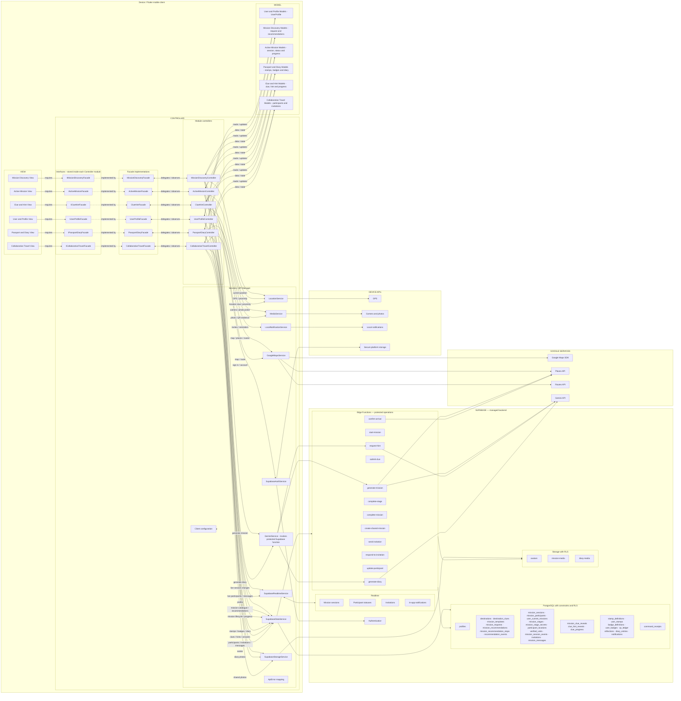
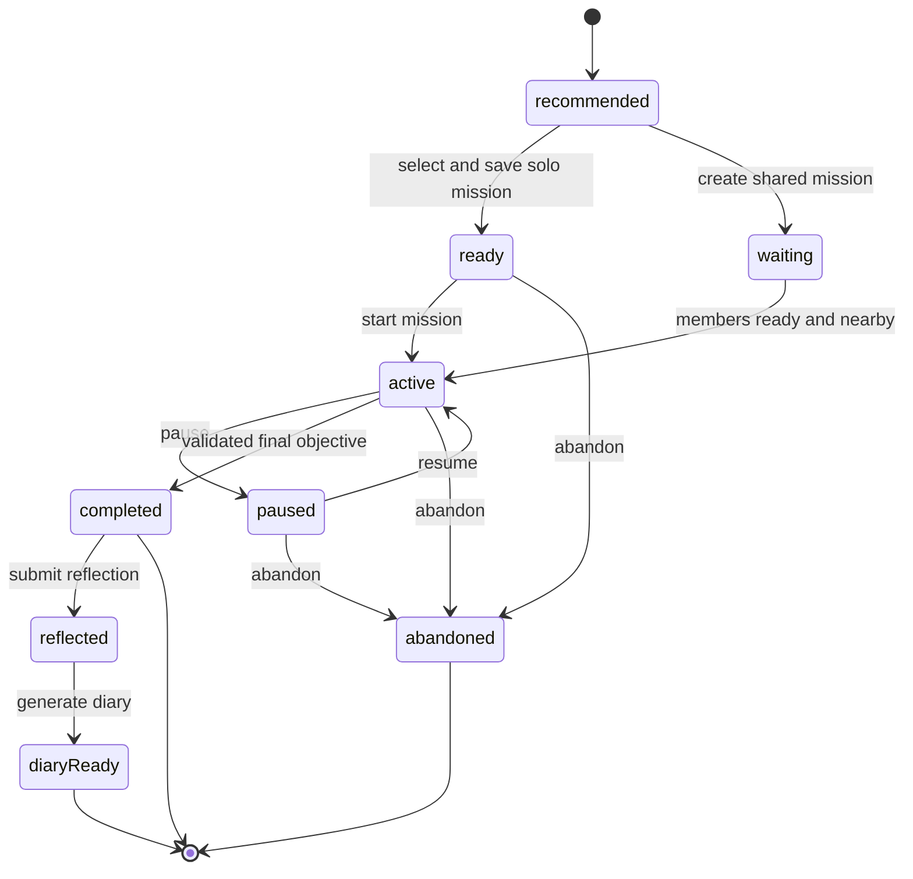

# Mystery Malaysia MVC Architecture

Status: **Accepted — implementation contract**
Architecture: **Facade-mediated client-side Model–View–Controller (MVC)**
Platform: Flutter mobile application
External services: Supabase, Google Maps Platform, Gemini API

All production code must follow this document. Update this document whenever an MVC component, API Manager, external provider, database table, or route changes.

## 1. Architecture decision

The Flutter application uses MVC with an interface-based Facade boundary:

- **View:** renders Flutter UI and communicates only through a Facade interface.
- **Facade interface:** defines the operations and observable state available to a View. It is stored inside its module under `controller/`, not in a separate architecture layer.
- **Facade implementation:** provides one simplified module entry point and delegates work to Controllers.
- **Controller:** owns UI/workflow state, validates actions, coordinates Models, and calls API Managers.
- **Model:** represents application data and deterministic state rules. Models do not render UI or call APIs.
- **API Managers/Services:** isolate Supabase, Google Maps, Gemini, and device SDK calls. They live inside the Controller layer as shown in the approved diagram; they are not a fourth MVC layer.

The application has no separately maintained custom server. Supabase is the managed backend. Production Gemini requests pass through a Supabase Edge Function so the Gemini credential is not embedded in the mobile application.

## 2. Complete component diagram



## 3. Allowed communication

```text
View ──user action / state read──> Facade interface
Facade interface <──implemented by── Facade implementation
Facade implementation ──delegates / observes──> Controller

Controller ──reads/updates──> Model
Controller <──data/state───── Model

Controller ──request──> API Manager / Service ──> External API
Controller <──Model──── API Manager / Service <── External API
```

Rules:

- Views may import Facade interfaces, Models required for display, shared widgets, theme, and the app composition factory.
- Views never import or construct Controllers, concrete Facades, or Services.
- Views never call Supabase, Google Maps services, Gemini, Storage, or device APIs directly.
- Concrete Facades wrap Controllers and expose only module-level operations and observable state.
- Controllers may import Models and Services. They contain no Flutter widget-building code.
- Models import neither Flutter UI nor Services.
- Services own all external SDK/API calls and convert responses into Models or typed errors.
- One Controller may coordinate several Services. Do not create a single global `ApiManager` switchboard.

## 4. Required repository organization

The MVC architecture folders are `view`, `controller`, and `model`. Application-shell, theme, and reusable-widget files are internal implementation details of the View layer, so they do not add components to the submitted architecture diagram.

```text
lib/
|-- main.dart
|-- view/
|   |-- app.dart                     # application widget
|   |-- app_router.dart              # application routes
|   |-- app_shell.dart               # bottom navigation shell
|   |-- app_theme.dart               # Material theme
|   |-- app_colors.dart              # shared presentation colours
|   |-- app_spacing.dart             # shared presentation spacing
|   |-- app_typography.dart          # shared presentation typography
|   |-- *.dart                       # reusable presentation widgets
|   |-- user_profile/
|   |-- mission_discovery/
|   |-- active_mission/
|   |-- passport_diary/
|   |-- clue_hint/
|   `-- collaborative_travel/
|-- controller/
|   |-- app_dependencies.dart
|   |-- user_profile/                # controller, facade and interface
|   |-- mission_discovery/           # controller, facade and interface
|   |-- active_mission/              # controller, facade and interface
|   |-- passport_diary/              # controller, facade and interface
|   |-- clue_hint/                    # controller, facade and interface
|   |-- collaborative_travel/        # controller, facade and interface
|   `-- services/                    # Services / API Manager box
|       |-- config/
|       |-- errors/
|       |-- supabase/
|       |-- gemini/
|       `-- device/
`-- model/
    |-- user_profile/
    |-- mission_discovery/
    |-- active_mission/
    |-- passport_diary/
    |-- clue_hint/
    `-- collaborative_travel/
```

The facade interface for each module remains inside that module's `controller` directory. No separate top-level `interfaces`, `facades`, `services`, `config`, or `errors` folder is allowed.

### Official module boundaries

| Module | Includes |
| --- | --- |
| User and Profile | onboarding, authentication, account recovery and profile |
| Mission Discovery | home discovery entry, request constraints, AI recommendations, mission preview, search |
| Active Mission | start, pause, resume, abandon, map, proximity, arrival, mission progress and completion |
| Passport and Diary | three-piece state mission badges, progression, history, reflections and generated diaries |
| Clue and Hint | clue formats, answers, hint levels, hint costs and clue progress |
| Collaborative Travel | direct invitations, lobby, participant status, team gameplay and shared diary |

Naming:

- Views end in `_view.dart`.
- Facade contracts begin with `I` and end in `Facade`.
- Facade implementations end in `Facade` and are created only by `app_dependencies.dart`.
- Controllers end in `_controller.dart`.
- Models use the entity name, such as `mission_session.dart`.
- External integrations end in `_service.dart`, such as `supabase_auth_service.dart`.
- Never create generic `Helper`, `Manager`, `Utils`, or global API switchboard classes.

## 5. Component responsibilities

### View

- Build accessible Flutter UI.
- Display state exposed by a Facade interface.
- Forward taps, form submissions, navigation intent, and retry actions.
- Keep only temporary visual state such as animation or field focus locally.

### Facade interface and implementation

- Define the only operations and observable state available to a View.
- Hide Controllers, Services, and workflow coordination behind one module-level entry point.
- Delegate work to Controllers and forward `ChangeNotifier` updates through `Listenable`.
- Contain no Flutter widget-building code.

### Controller

- Hold loading, success, and error state for a screen or workflow.
- Validate user actions before sending requests.
- Call Services and update Models/state.
- Coordinate mission generation, pause/resume, clue submission, arrival, diary generation, and collaboration.
- Expose user-safe errors to the View.

### Model

- Store typed application data.
- Define statuses and deterministic state transitions.
- Remain independent from Flutter widgets and external SDKs.

### API Manager / Service

- Authenticate and execute provider calls.
- Convert JSON/provider objects into Models.
- Map provider failures into `ApiError`.
- Keep provider-specific code out of Controllers.

## 6. API placement

| API | Client service location | External target |
| --- | --- | --- |
| Supabase authentication | `lib/controller/services/supabase/supabase_auth_service.dart` | Supabase Auth |
| Supabase database/functions | `lib/controller/services/supabase/supabase_data_service.dart` | PostgreSQL and Edge Functions |
| Supabase file storage | `lib/controller/services/supabase/supabase_storage_service.dart` | Supabase Storage |
| Supabase realtime | `lib/controller/services/supabase/supabase_realtime_service.dart` | Supabase Realtime |
| Maps, Places, Routes | `lib/controller/services/google_maps/google_maps_service.dart` | Google Maps Platform |
| Gemini generation | `lib/controller/services/gemini/gemini_service.dart` | Protected Supabase Edge Function → Gemini |
| GPS/camera/notifications | `lib/controller/services/device/` | Mobile device APIs |

The Supabase URL and publishable key may be in client configuration. The Supabase service-role key and Gemini credential must never be shipped in the Flutter app. Mobile Maps keys must be restricted by Android package/SHA certificate or iOS bundle identifier and by API.

## 7. Mission lifecycle



The `ActiveMissionController` requests transitions. The `MissionSession` Model represents status. `SupabaseDataService` invokes protected functions. While an active mission screen is open, the Controller samples foreground GPS every 15 seconds; a server-confirmed `reached` proximity automatically invokes `confirm-arrival` once for that stage and the View presents the destination guide. PostgreSQL constraints and functions remain authoritative for completion and rewards.

## 8. Supabase data

The full schema, relationships, RLS rules and storage layout are defined in [`docs/DATABASE.md`](DATABASE.md) and implemented by [`supabase/migrations/202607250001_initial_schema.sql`](../supabase/migrations/202607250001_initial_schema.sql).

```text
auth.users
profiles
destinations
destination_clues
mission_templates
mission_requests
mission_recommendations
mission_recommendation_stops
recommendation_events
mission_sessions
mission_participants
user_current_missions
mission_stages
mission_stage_secrets
mission_clue_reveals
clue_hint_reveals
clue_progress
participant_locations
verified_visits
mission_session_events
invitations
mission_messages
stamp_definitions
user_stamps
badge_definitions
user_badges
xp_ledger
reflections
diary_entries
notifications
command_receipts
```

Use UUID keys, foreign keys, constraints, timestamps, indexes, and RLS. Users may access their own records and shared-mission records only when membership exists. Reward and curated-content writes are protected operations.

Storage buckets:

```text
avatars/{uid}/{file}
mission-media/{sessionId}/{uid}/{file}
diary-media/{uid}/{entryId}/{file}
```

## 9. Network and notifications

The app requires an internet connection. It does not download missions, queue offline mutations, or synchronize offline changes. Network failures show **Connection required** with Retry.

Supabase Realtime supplies in-app notifications. Native local notifications supply scheduled reminders. Closed-app remote push is deferred until required.

## 10. Navigation

```text
/splash
/onboarding
/auth/sign-in
/auth/register
/home
/explore
/missions/request
/missions/:id/preview
/play/:sessionId/*
/passport
/diary
/invitations
/shared/:sessionId/*
/search
/notifications
/profile
```

Public routes are splash, onboarding, and authentication. Other routes require a session. Gameplay routes require mission membership. The authenticated shell contains Home, Explore, Passport, Invitations, and Profile.

## 11. Testing and compliance

- Mirror `lib` under `test`.
- Unit-test Facades, Controllers with branching workflow logic, and Models with state rules.
- Widget-test Views and shared widgets.
- Test Services with provider fakes or the Supabase local stack.
- Test migrations, RLS, Storage policies, and protected functions.

A change complies when `lib` has the three MVC directories plus only the approved `app`, `theme`, and `widgets` support directories; Views import Facade interfaces but no Controllers, concrete Facades, or Services; every interface is stored inside its MVC layer; Facades contain no widget-building code; Controllers contain no Flutter widget-building or provider code; Models contain no UI/provider dependencies; and client integrations are under `lib/controller/services`.
