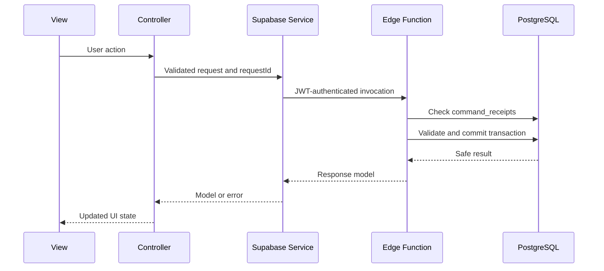

# Mystery Malaysia Database Structure

Status: **Accepted - database implementation contract**
Database: Supabase PostgreSQL
Migrations: `supabase/migrations/202607250001_initial_schema.sql` through
`supabase/migrations/202607260003_dynamic_destination_discovery.sql`

This schema supports the six MVC modules, multi-destination missions, solo and
collaborative play, one canonical clue per destination, and one optional
additional hint per user for each mission stage. MVC determines client code
organization; PostgreSQL relationships remain normalized across modules.

## 1. Core cardinality rules

```text
Mission request       1 -> 0..3 recommendations
Recommendation        1 -> 1..many ordered destinations
Mission session       1 -> 1..many ordered stages
Mission stage         1 -> 1 hidden destination
Destination           1 -> 0..1 canonical clue
Usable mission stop   1 -> 1 canonical clue
Canonical clue        1 -> 0..1 optional hint
User + mission stage  1 -> 0..1 hint reveal
User + mission stage  1 -> 0..1 verified visit
User + destination    1 -> 0..1 passport stamp
User + session        1 -> 0..1 reflection
User + session        1 -> 0..1 individual diary
Collaborative session 1 -> 0..1 shared diary
User                   1 -> 0..1 current mission
Destination            1 -> 0..many safety reviews
Destination            1 -> 0..many allocation records
Destination            1 -> 0..1 live allocation
```

The database-enforced clue and hint constraints are:

```sql
destination_clues.destination_id primary key
clue_hint_reveals primary key (stage_id, user_id)
```

Therefore, a destination cannot have a second canonical clue. A destination
without a clue cannot be placed in a recommendation or session. A user cannot
request a second additional hint for the same destination stage.

## 2. Module ownership

| MVC module | Primary tables |
| --- | --- |
| User and Profile | `profiles` and Supabase Auth |
| Mission Discovery | `destinations`, `destination_clues`, `destination_safety_reviews`, `destination_allocations`, `mission_templates`, `mission_requests`, `mission_recommendations`, `mission_recommendation_stops`, `recommendation_events` |
| Active Mission | `mission_sessions`, `user_current_missions`, `mission_stages`, `mission_stage_secrets`, `verified_visits`, `mission_session_events` |
| Clue and Hint | `destination_clues`, `mission_clue_reveals`, `clue_hint_reveals`, `clue_progress` |
| Passport and Diary | `stamp_definitions`, `user_stamps`, `badge_definitions`, `user_badges`, `xp_ledger`, `reflections`, `diary_entries` |
| Collaborative Travel | `mission_participants`, `participant_locations`, `invitations`, `mission_messages` |
| Shared infrastructure | `notifications`, `command_receipts`, Supabase Auth, Supabase Storage and Realtime |

## 3. Complete entity relationship diagram

High-resolution exports: [PNG](mystery_malaysia_complete_erd.png) |
[SVG](mystery_malaysia_complete_erd.svg). The SVG is recommended when zooming
or printing because it remains sharp at any size.

```mermaid
erDiagram
    AUTH_USERS ||--|| PROFILES : has
    AUTH_USERS ||--o{ MISSION_REQUESTS : creates
    AUTH_USERS ||--o{ DESTINATION_ALLOCATIONS : receives
    AUTH_USERS ||--o{ MISSION_PARTICIPANTS : joins
    AUTH_USERS ||--o| USER_CURRENT_MISSIONS : resumes
    AUTH_USERS ||--o{ PARTICIPANT_LOCATIONS : reports
    AUTH_USERS ||--o{ CLUE_HINT_REVEALS : requests
    AUTH_USERS ||--o{ CLUE_PROGRESS : records
    AUTH_USERS ||--o{ VERIFIED_VISITS : verifies
    AUTH_USERS ||--o{ INVITATIONS : sends_or_receives
    AUTH_USERS ||--o{ MISSION_MESSAGES : sends
    AUTH_USERS ||--o{ USER_STAMPS : earns
    AUTH_USERS ||--o{ USER_BADGES : earns
    AUTH_USERS ||--o{ XP_LEDGER : receives
    AUTH_USERS ||--o{ REFLECTIONS : writes
    AUTH_USERS ||--o{ DIARY_ENTRIES : owns
    AUTH_USERS ||--o{ NOTIFICATIONS : receives
    AUTH_USERS ||--o{ COMMAND_RECEIPTS : submits

    DESTINATIONS ||--o| DESTINATION_CLUES : has
    DESTINATIONS ||--o{ DESTINATION_SAFETY_REVIEWS : assessed_by
    DESTINATIONS ||--o{ DESTINATION_ALLOCATIONS : coordinated_by
    DESTINATIONS ||--o{ MISSION_RECOMMENDATION_STOPS : selected_for
    DESTINATIONS ||--o{ MISSION_STAGE_SECRETS : targets
    DESTINATIONS ||--o| STAMP_DEFINITIONS : awards
    DESTINATION_CLUES ||--o{ MISSION_RECOMMENDATION_STOPS : enables
    DESTINATION_CLUES ||--o{ MISSION_STAGE_SECRETS : supplies

    MISSION_REQUESTS ||--o{ MISSION_RECOMMENDATIONS : produces
    MISSION_REQUESTS ||--o{ DESTINATION_ALLOCATIONS : reserves
    MISSION_REQUESTS ||--o{ RECOMMENDATION_EVENTS : logs
    MISSION_RECOMMENDATIONS ||--|{ MISSION_RECOMMENDATION_STOPS : routes
    MISSION_RECOMMENDATIONS ||--o{ RECOMMENDATION_EVENTS : logs
    MISSION_RECOMMENDATIONS ||--o{ DESTINATION_ALLOCATIONS : holds
    MISSION_RECOMMENDATIONS o|--o| MISSION_SESSIONS : starts
    MISSION_TEMPLATES ||--o{ MISSION_RECOMMENDATION_STOPS : shapes

    MISSION_SESSIONS ||--|{ MISSION_PARTICIPANTS : contains
    MISSION_SESSIONS ||--o{ USER_CURRENT_MISSIONS : resumes
    MISSION_SESSIONS ||--|{ MISSION_STAGES : contains
    MISSION_SESSIONS ||--o{ PARTICIPANT_LOCATIONS : receives
    MISSION_SESSIONS ||--o{ VERIFIED_VISITS : verifies
    MISSION_SESSIONS ||--o{ MISSION_SESSION_EVENTS : records
    MISSION_SESSIONS ||--o{ INVITATIONS : sends
    MISSION_SESSIONS ||--o{ MISSION_MESSAGES : contains
    MISSION_SESSIONS ||--o{ USER_STAMPS : awards
    MISSION_SESSIONS ||--o{ USER_BADGES : awards
    MISSION_SESSIONS ||--o{ XP_LEDGER : awards
    MISSION_SESSIONS ||--o{ REFLECTIONS : receives
    MISSION_SESSIONS ||--o{ DIARY_ENTRIES : generates

    MISSION_PARTICIPANTS ||--o| USER_CURRENT_MISSIONS : activates
    MISSION_PARTICIPANTS ||--o| PARTICIPANT_LOCATIONS : reports
    MISSION_PARTICIPANTS ||--o{ VERIFIED_VISITS : verifies
    MISSION_PARTICIPANTS ||--o{ INVITATIONS : invites
    MISSION_PARTICIPANTS ||--o{ MISSION_MESSAGES : sends

    MISSION_STAGES ||--|| MISSION_STAGE_SECRETS : protects
    MISSION_STAGES ||--o| MISSION_CLUE_REVEALS : displays
    MISSION_STAGES ||--o{ CLUE_HINT_REVEALS : reveals
    MISSION_STAGES ||--o{ CLUE_PROGRESS : tracks
    MISSION_STAGES ||--o{ VERIFIED_VISITS : confirms
    MISSION_STAGES ||--o{ USER_STAMPS : awards
    MISSION_STAGES ||--o{ XP_LEDGER : awards

    STAMP_DEFINITIONS ||--o{ USER_STAMPS : collected_as
    BADGE_DEFINITIONS ||--o{ USER_BADGES : earned_as
```



## 4. Table dictionary

### User and Profile

| Table | Purpose | Key integrity rule |
| --- | --- | --- |
| `profiles` | Username, display name, avatar and profile visibility | `id` equals the Supabase Auth user ID; usernames are case-insensitively unique |

Email, phone number, password hashes, providers and sessions remain in
`auth.users`; they are not duplicated in `profiles`.

### Mission Discovery

| Table | Purpose | Key integrity rule |
| --- | --- | --- |
| `destinations` | Server-side cache and safety registry for curated or Gemini/Google Maps-grounded places | Google Place ID is unique; coordinates, rating, review count, discovery score and safety status are validated |
| `destination_clues` | Server-only canonical clue, answer rules and optional hint | `destination_id` is the primary key: at most one clue per destination; only destinations with a clue can become mission stops |
| `destination_safety_reviews` | Server-only automated, manual and incident review evidence | Every review belongs to one destination and records status, score and expiry |
| `destination_allocations` | Server-only reservation/history record used to distribute explorers | A partial unique index permits only one live `reserved` or `active` allocation per destination |
| `mission_templates` | Optional administrator-controlled mission generation rules | Stop, duration and budget ranges are validated |
| `mission_requests` | Immutable snapshot of one recommendation request | Contains location, time, budget, distance, categories, style, state and group constraints |
| `mission_recommendations` | Up to three safe mission choices shown to the requester | `unique(request_id, recommendation_rank)` |
| `mission_recommendation_stops` | Server-only ordered hidden destinations for each recommendation | Unique stop number and unique destination within a recommendation |
| `recommendation_events` | Server-only generation, regeneration, acceptance and failure audit log | Stores AI model, prompt version and payload |

Recommendation frequency remains derivable from
`mission_recommendation_stops.destination_id`. `destination_allocations` is not
a popularity counter: it is the concurrency lock and per-user assignment
history used to avoid repeats and simultaneous crowding.

Gemini discovers candidate places, Google Maps grounding supplies real place
identifiers, Google Places Details verifies structured location and public
rating evidence, and the Edge Function calculates tourist-suitability,
hidden-gem and distance-fit scores. These automated scores are prioritization
signals, not a guarantee of personal safety. A curated catalogue remains as the
failure fallback.

### Active Mission

| Table | Purpose | Key integrity rule |
| --- | --- | --- |
| `mission_sessions` | A selected solo or collaborative mission | One session per accepted recommendation; validated lifecycle timestamps |
| `mission_participants` | Membership, host/member role, readiness and completion state | One participant row per user per session; one active host |
| `user_current_missions` | Resume pointer for the dashboard | `user_id` primary key enforces one current mission |
| `mission_stages` | Player-visible ordered stage and shared progress | Unique stage number per session; at most one active stage |
| `mission_stage_secrets` | Server-only destination and geofence for a stage | Exactly one hidden destination per stage |
| `participant_locations` | Latest temporary coordinates for group-distance checks | One latest row per participant; removed when the mission finishes |
| `verified_visits` | Server-written GPS/geofence evidence | One verified visit per user per stage |
| `mission_session_events` | Append-only mission lifecycle audit and realtime event source | Ordered identity key plus session timestamp index |

A recommendation and a session can contain multiple destinations. Each ordered
destination becomes one `mission_stage`. This is the structure required by the
route-building and checkpoint requirements.

### Clue and Hint

| Table | Purpose | Key integrity rule |
| --- | --- | --- |
| `destination_clues` | Protected canonical clue, accepted answers and the optional hint | One row per destination; only one `hint_text` field |
| `mission_clue_reveals` | Safe clue content copied to an unlocked stage | `stage_id` primary key gives one visible clue per stage |
| `clue_hint_reveals` | Safe copy of the additional hint requested by a user | `(stage_id, user_id)` primary key prevents a second request |
| `clue_progress` | User attempts, solved state and whether the hint was used | One row per user per stage; `hint_used` is boolean |

`destination_clues` is inaccessible to the mobile client. The protected hint
function reads the single optional `hint_text` and inserts
`clue_hint_reveals`. A duplicate insert fails at the primary key even if the
client retries or sends concurrent requests.

### Passport and Diary

| Table | Purpose | Key integrity rule |
| --- | --- | --- |
| `stamp_definitions` | One passport stamp design for each destination | `destination_id` is unique |
| `user_stamps` | Stamps earned from verified visits | `(user_id, stamp_id)` prevents duplicate lifetime awards |
| `badge_definitions` | Badge catalogue and criteria | Unique badge code |
| `user_badges` | Badges awarded to users | `(user_id, badge_id)` prevents duplicates |
| `xp_ledger` | Append-only XP credits and debits | Partial unique indexes prevent duplicate session or stage awards |
| `reflections` | One participant reflection after a completed mission | `unique(user_id, session_id)` |
| `diary_entries` | Individual and collaborative AI travel diaries | One individual diary per user/session and one shared diary per session |

XP totals are calculated from `sum(xp_ledger.amount)` and are not stored as a
mutable profile total.

### Collaborative Travel and shared infrastructure

| Table | Purpose | Key integrity rule |
| --- | --- | --- |
| `invitations` | Direct shared-mission invitation and response | No friendship is required; a user can be invited only once per session |
| `mission_messages` | Participant text, reactions and system messages | Sender must be a mission participant |
| `notifications` | In-app notification inbox | The client can update only `read_at` |
| `command_receipts` | Server-only idempotency results for protected mutations | One result per client `request_id` |

Invitations do not use a friendship table. The `send-invitation` Edge Function
accepts a username, email address or phone number, resolves it to one
`auth.users.id`, and stores only that ID as `invitations.invitee_id`. Username
lookup uses `profiles`; email and phone lookup stays server-side in
`auth.users`. A generic response should be returned when no account matches so
the endpoint does not expose whether an email address or phone number is
registered.

## 5. Mystery and privacy boundaries

The following tables are server-only: RLS is enabled, but the authenticated
role receives no grants or policies.

- `destination_clues`
- `mission_templates`
- `mission_recommendation_stops`
- `recommendation_events`
- `mission_stage_secrets`
- `command_receipts`

The mobile client can see:

- recommendation titles, explanations, estimates and difficulty, but not route destinations;
- mission stage numbers and progress, but not hidden destination IDs;
- only the clue copy for an unlocked stage;
- only its own revealed hint and verified GPS evidence;
- full destination details only after its visit has been verified.

The `can_view_destination()` security-definer helper enforces the final rule by
joining the protected stage mapping to the user's `verified_visits`.

## 6. Row Level Security

Every public table has RLS enabled.

- Users manage only their own profile, requests, reflections and individual
  diaries.
- Mission participants read only sessions they joined.
- Exact participant locations and verified GPS evidence are visible only to
  their owner; group status is exposed through `mission_participants`.
- Reward, mission progress, destination reveal and shared diary writes are
  service-role only.
- Shared diaries are readable only by mission participants.
- Destination and stamp-definition rows become readable only after the
  corresponding verified award condition.
- Protected mystery tables have no authenticated grants or policies.

## 7. Required protected transactions

The Edge Functions must perform these operations transactionally:

1. `generate-mission`: create the request results, ordered recommendation stops
   and recommendation event.
2. `start-mission`: create the session, participants, ordered stages, protected
   stage mappings and the first safe clue reveal.
3. `send-invitation`: resolve a username, email or phone number through the
   service role, reject duplicates, and insert the invitation using `invitee_id`.
4. `request-hint`: verify active stage and unsolved destination, insert the
   single hint reveal, mark `hint_used`, and apply any XP cost.
5. `submit-clue`: validate against `destination_clues` and update progress.
6. `confirm-arrival`: validate GPS accuracy and geofence, insert the verified
   visit and unlock the destination.
7. `complete-stage`: award the destination stamp and unlock the next stage.
8. `complete-mission`: finish participants/session, award badges and XP, and
   remove current-mission and temporary location rows.
9. `generate-diary`: use only verified visits and submitted reflections, then
   create either the individual diary or the single shared diary.

Every protected command checks `command_receipts` using a client-generated UUID
before writing, preventing duplicate rewards and repeated command effects.

## 8. Storage

| Bucket | Path | Purpose |
| --- | --- | --- |
| `avatars` | `{userId}/{file}` | Profile avatars |
| `mission-media` | `{sessionId}/{userId}/{file}` | Mission evidence |
| `diary-media` | `{userId}/{diaryId}/{file}` | Diary photos |

All buckets are private. Authenticated users manage their own objects. Shared
media is delivered through short-lived signed URLs after an Edge Function
verifies mission membership.

## 9. Protected write flow


